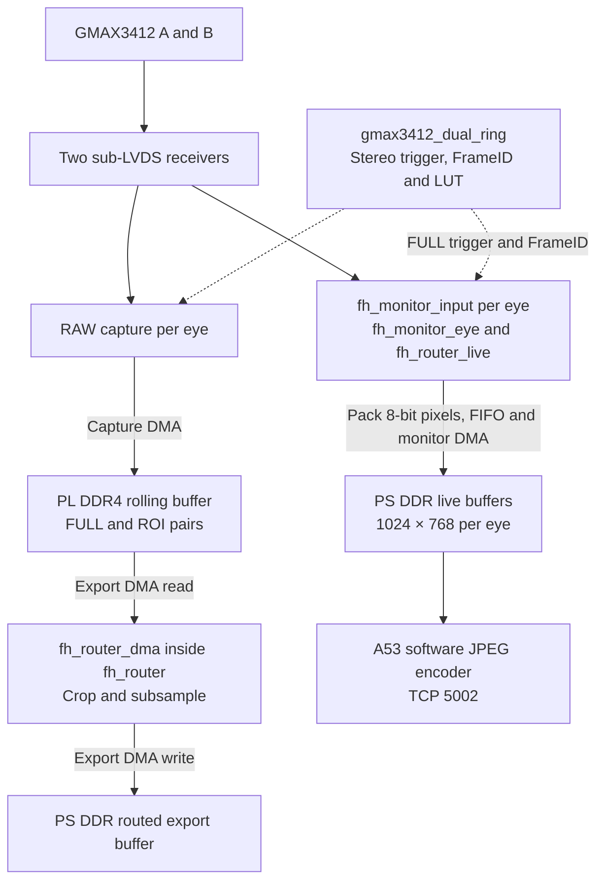

# FH_Test — V35.2

Two physical GMAX3412 receivers on FH_Carrier. Startup reports independent initialization and 16-lane training results. UART 8 and 9 open sensor diagnostics. Enter C1 or C2 with an optional exposure in microseconds, followed by Enter (for example C2:2000). The default is 1000 us. U:3000 sets a 3000 us exposure on both sensors for this run and asks for R and duration. Plain U also prompts for exposure (default 1000 us). U arms both receivers and strobes both TEXP1 lines together. R selects how many central 4096 × 1024 crops to retain between full frames. Both sensors read full frames. Busy 4 ms timer slots are skipped. N exports retained images; Ethernet sensor indices are 0 and 1.

## Changes in V35.2

- Vivado builds and exports FH_Firmware. Vitis builds FH_TestPlatform and FH_TestApp. The build scripts and desktop JTAG defaults use these names.
- The desktop application can upload BOOT.BIN and image.ub to eMMC and verify the transfer.
- Validation included bitstream generation, verification of the bitstream embedded in the exported XSA, and a successful build of the renamed Vitis application.

## Changes in V35.1

- Two router implementations support independent crop and subsampling paths. Each live monitor reads its GMAX3412 receiver directly. Routed export reads a retained frame from PL DDR4 through AXI DMA.
- The bare-metal A53 serves synchronized 1024 × 768 grayscale JPEG pairs on TCP 5002 during acquisition. Stored-frame export uses TCP 5001.
- FH_Test displays live video in the Sensor 1 and Sensor 2 panels. The monitor toggle sits beside Previous and Next, and Stop capture sits beside Start capture. The RTC and monitor buttons follow board readiness.
- Vivado functional simulation passed eight DMA-router cases and six live-router cases, including full-frame subsampling and error handling.

## Programmable logic dataflow

Each receiver feeds both image paths. Solid arrows carry pixels. Dashed arrows carry capture control and frame identification.



## Standalone stereo JPEG monitor

During UART U acquisition, click **Live Stereo Monitor** beside **Next** once the board reports that TCP 5002 is listening. Sensor 1 and Sensor 2 then show the live pair. Click the button again to return to the stored images. Choose R=0 for focusing, or R=24 to retain 24 ROI pairs between FULL pairs,
and duration 0 for continuous capture. The default board IP is 192.168.1.123;
the viewer connects to TCP 5002. Each reply carries a common FULL FrameID and
two independent 1024 × 768 grayscale JPEGs. A53 standalone encodes the two
live router outputs. RAW rolling-buffer acquisition continues without a viewer.

The wheel centres the new ROI on the cursor, clamped at sensor boundaries.
The other eye retains its centre. At 1×, 2× and 4× the hardware pixel steps
are 4, 2 and 1. Beyond 4×, only the client crops and scales its received JPEG.
Full field resets both eyes. Maximum target is 10 pairs/s, subject to A53
and LAN throughput. For the default standalone build clear any old AMP setting
with `Remove-Item Env:FH_MONITOR_AMP -ErrorAction SilentlyContinue` in the
same PowerShell session. The deferred [VCU profile](software/monitor/README.md)
is separate.

## Project names

`FH_Test` is the repository and desktop application name. The Vivado project and the two Vitis components use the following names. Paths are relative to the repository root.

| Component | Previous name | Current name | Generated project or executable |
| --- | --- | --- | --- |
| Vivado project | `FH_Emulator` | `FH_Firmware` | `hardware/vivado/FH_Firmware.xpr` |
| Vitis platform | `FH_Emulator_platform` | `FH_TestPlatform` | `software/workspace/FH_TestPlatform/export/FH_TestPlatform/FH_TestPlatform.xpfm` |
| Vitis application | `FH_Emulator_App` | `FH_TestApp` | `software/workspace/FH_TestApp/build/FH_TestApp.elf` |

Vivado names the implementation bitstream `FH_Carrier_Bringup_top.bit` after the top-level RTL module. The export step copies it to `hardware/exports/FH_Firmware.bit` and writes the matching `FH_Firmware.ltx` debug probes and `FH_Firmware.xsa` hardware handoff in the same directory. Vitis uses that XSA to build `FH_TestPlatform`.

## Build V35.2

Close Vivado and Vitis, then run the following command from the FH_Test project root.

```powershell
powershell -ExecutionPolicy Bypass -File .\scripts\build_all.ps1
```

The script creates the Vivado project if needed, runs synthesis and implementation through bitstream generation, validates and exports the XSA, and builds the Vitis platform and application. Vivado logs are under `hardware/results` and Vitis logs are under `software/logs`.

On the first build after the rename, the script creates the new projects from the tracked sources. If you edited sources directly in an earlier Vitis workspace, reconcile those edits with `software/app/src` before building.

If bitstream generation has already completed in `FH_Firmware`, run the following from the repository root to reuse that implementation, export the hardware and build the Vitis platform and application.

```powershell
powershell -ExecutionPolicy Bypass -File .\scripts\export_build.ps1
```

## Previous revision and build instructions

# FH_Firmware V34 — FH_Carrier

19 November 2026. The physical FH_Sen4K / GMAX3412-A single-frame capture workflow has been verified on FH_Carrier.

## Changes in V34

- Capture a normal 4096 × 3072, 10-bit image with **C** in the main UART menu or **Capture GMAX-A** in FH_Test. On first use, the firmware powers and configures the sensor, calibrates its PHY and trains all 16 sub-LVDS lanes. Later captures reuse the initialized receiver. The physical exposure pulse is 1 ms.
- The receiver detects the start-of-frame marker on each lane and compensates up to one RX word clock of skew per frame. The ramp checker and DMA consume the same aligned words. The receiver ILA exposes all 16 lanes before alignment.
- In sensor submenu **8**, **V** checks a full test ramp through EOF, **W** stores a new test frame and **C** stores a normal image. The simulation covers changing lane delays, rejection beyond the configured margin and recovery on a subsequent frame.
- DMA stores each full frame as 24 MiB in the PL DDR4 rolling buffer. Main-menu **C** publishes its FrameID and opens Ethernet export. FH_Test refreshes the catalog and can download and display the selected Sensor 0 image. Bench verification covered the full test ramp, DDR storage, Gigabit Ethernet transfer and display.

## Release status

- SATA port 0 has established a Gen3 6 Gb/s link and completed read-only ATA
  IDENTIFY with a valid checksum, reporting model, serial, firmware and capacity.
  The recorded test had zero idle-observation and IDENTIFY transfer errors.
- After replacement of the carrier Ethernet connector, physical link stability
  has been confirmed by repeated power-cycle tests. Direct FH_Carrier-to-PC
  Ethernet image transfer is reported working.
- **Known limitation:** image transfers through the router with the PC on Wi-Fi
  can pause for many seconds or reach the PC receive timeout. A captured transfer
  recovered and completed after TCP retransmission. The cause is not yet isolated;
  direct-cable success does not establish reliability on every network path.
  The next comparison is both devices wired to the same router, with PC Wi-Fi off.
- These are bench observations, not full production qualification or timing signoff
  for every source revision.

## Projects to open

- Vivado 2025.2: `hardware/vivado/FH_Firmware.xpr`.
- Vitis 2025.2 workspace: `software/workspace`.
- Platform: `FH_TestPlatform`.
- Application: `FH_TestApp`, standalone A53 #0, 64-bit.
- BSP domain: `standalone` (short name avoids Windows object-path limits).
- Desktop application: `python FH_Test.py` from the repository root.
  Its V34 title, saved settings and default programming paths are carrier-specific.
  Dependencies remain in `software/host/requirements.txt`.

The Vivado top retains the name `FH_Carrier_Bringup_top` because the validated
carrier XDC and receiver ILA hook reference its hierarchy. This is not the old
project: all source/IP paths resolve inside FH_Test.

## Included features

| Area | FH_Carrier V34 behavior |
| --- | --- |
| PS clocks | FH_Bringup PS DDR/MIO/GTR configuration; SATA 150 MHz RefClk0, USB3 100 MHz RefClk1 |
| PCIe clock | External 100 MHz reference monitor, divided clock/Gray CDC and corrected constraints; no new PCIe endpoint or storage driver |
| Board diagnostics | Power-good/reset GPIO, EEPROM dump/EUI-48, PAC1944 identification and rail measurements |
| SATA | CEVA host setup, COMRESET, stable-link and idle-error checks, read-only ATA IDENTIFY; no disk-sector reads or writes |
| I2C | PS I2C0 on MIO 74–75, PS I2C1 over EMIO to PAC1944, AXI IIC for GMAX_A |
| Sensor control | FH_Sen4K/GMAX3412-A power/reset/clock control, I2C/SPI access, configuration table, PHY calibration, training and receiver diagnostics |
| Receiver | 16-lane GMAX-A sub-LVDS receiver with per-frame word alignment and raw RX ILA |
| Acquisition | Two emulators, 250 Hz slots, FULL + R ROI, discarded busy slots, ordered stereo storage in 4 GiB PL DDR4 |
| Metadata | Hardware Frame_Addr_LUT, FrameID/TimerPulse, overwrite invalidation and retained-pixel verification |
| Router | FULL subsampling and ROI rectangle extraction; control at 0xA00C0000, export DMA at 0xA00D0000 |
| Ethernet | GEM0 MIO 26-37, MDIO 76-77, EEPROM EUI-48 with explicit bench fallback; gigabit-only autonegotiation, TCP 5001, raw/routed downloads and TCP/DMA stall diagnostics |
| Console | UART0 MIO 42–43, 115200 8N1 |

Router control uses `axi_smc/M13_AXI` and `M14_AXI`; its PL DDR read uses
`pl_ddr_smc/S03_AXI`. Its write channel shares `gmax_ddr_smc` through the new
`S01_AXI` input and writes PS DDR through the existing HP0 path. Both run at
120 MHz. Existing capture/legacy-owner paths and register addresses are retained.

Vitis generates drivers/FSBL from the carrier XSA. An application-local PHY
override supplies the current RTL8211F initialization (see below), without
patching the installed BSP sources. Default IP is 192.168.1.123/24, gateway
192.168.1.1. Use a unique IP and MAC for each board on the LAN.

## Compile in the GUIs

1. Open the carrier XPR. Open `design_1`, **Validate Design**, then **Generate
   Output Products**. Use global synthesis (already selected).
2. **Run Synthesis**, **Run Implementation**, then **Generate Bitstream**.
   Implementation uses Performance_Explore and the local receiver ILA hook.
3. Inspect timing/DRC/methodology. In the Vivado Tcl Console run:

   ```tcl
   source C:/Projects/FH_Test/hardware/scripts/export_gui.tcl
   ```

   This checks completed, current runs and timing (including pulse width and bus
   skew), then exports `hardware/exports/FH_Firmware.bit`, `.ltx` and `.xsa`.
   It does not compile. It refuses an incomplete/stale or failing implementation.
4. Open Vitis with `C:\Projects\FH_Test\software\workspace`.
   Update **FH_TestPlatform → Hardware Specification** to the final
   `hardware/exports/FH_Firmware.xsa`, replacing any design-only handoff.
5. **Build Platform**, including its freshly generated FSBL, then **Build
   Application**. Do not use a KFB or old FH_Bringup FSBL/ELF.
6. Create a hardware debug launch for A53 #0 using the matching BIT, carrier FSBL
   and application ELF, or use the carrier FH_Test **Program & Run** after builds.
   It checks artifact presence, embedded BIT equality and platform XSA consistency.

Initial platform settings: standalone stdin/stdout `psu_uart_0`; lwip220 RAW_API;
`no_sys_no_timers=true`, IPv6/DHCP disabled; TCP send/window 32768/16384;
512 TCP segments; memory 262144. Application heap/stack are 1 MiB/64 KiB.

Edit the native Vitis `software/workspace/FH_TestApp/src` after creation.
The tracked `software/app/src` is the creation snapshot; maintain it alongside
native edits for reproducibility. Build commands never silently reimport sources.

## Automated export and software build

After Generate Bitstream succeeds, save and close Vivado and Vitis, then run from
the repository root:

```powershell
powershell -NoProfile -ExecutionPolicy Bypass -File .\scripts\export_build.ps1
```

This exports and validates the existing implementation, updates the platform
from the final XSA, builds its BSP/FSBL, then builds the native application.
Missing Vitis components are created; existing application sources are preserved.
It stops on any failed stage and never launches synthesis, implementation or board
programming. Logs are in `hardware/results` and `software/logs`. Close the Vitis
workspace before running; the script never deletes workspace locks.

## Install PetaLinux boot files on the eMMC

Build the standalone Vitis platform and application with `scripts/software.ps1 -Stage BuildPlatform` followed by `scripts/software.ps1 -Stage BuildApp`. Load the resulting firmware over JTAG. The standalone platform includes the writable XilFFS library for the SOM's SD0 eMMC.

1. In FH_Test.py, connect UART, stop capture and select **Enter export**. An empty frame table is fine.
2. Select **Install PetaLinux on eMMC...** and choose the PC folder containing `BOOT.BIN` and `image.ub`. Confirm the destination. UART authorizes one update, and the configured Ethernet TCP endpoint carries both files.
3. Wait for **Verified BOOT.BIN and image.ub on eMMC.** The firmware stages both files on the existing FAT boot volume, rereads them and checks their sizes and CRC32 values before replacing the boot files. Allow enough free space for both new files. The updater reserves the `FHUPDATE` directory for staging and rollback. After an interrupted installation, rerun it from the standalone firmware before booting from eMMC.
4. Select the board's eMMC boot mode and power-cycle. The PetaLinux build must be configured to load this FIT and supply its root filesystem (embedded in the image or already provisioned). This operation updates the two named files on an existing FAT volume.

## Console and board checks

Expect the **FH_Firmware / FH_Carrier / V34** banner and startup board/clock
diagnostics. The main commands are:

| Command | Action |
| --- | --- |
| 1-7 | Power, EEPROM, PAC1944 and complete reference-clock diagnostics |
| 8 | GMAX_A sensor diagnostics submenu |
| S | SATA detection and read-only IDENTIFY; leaves output visible until another command |
| C | Capture one physical GMAX-A frame and open Ethernet export |
| U | Capture and verify stereo emulator frames with 250 Hz trigger slots |
| L | List valid rolling-buffer LUT entries |
| E | Observe PHY for 60 seconds before and 120 seconds after one initialization |
| N | Start/resume Ethernet export on TCP port 5001 |
| D during N | Show GEM, PHY and active TCP-transfer diagnostics |
| R | External reset test |
| H | Show menu on request |
| ESC | Stop the active U/N operation, or exit from the main console |

Submenu 8 also provides manual control of sensor power and streaming.
Run E from a fresh application session, before N; initialization changes PHY
configuration, while its before/after observation phases only read registers.

For stereo emulator export, run U, inspect L, then start N and connect with FH_Test.
N can start before capture: STATUS works, but image retrieval requires valid
retained frames. Commands are STATUS, LIST, GET, PAIR and RANGE. FH_Test retries
its read-only attachment STATUS probe for up to 45 seconds; image downloads
are not automatically retried and retain a 30-second socket receive timeout.

For each candidate build, run U/L/N and Router downloads. Check DDR calibration,
matching stereo counts, zero exposure extensions, retained pixels and CRCs.
Physical capture uses GMAX-A. Stereo capture uses the two emulators.

## Recreate from a clean checkout without compiling

Run Vivado batch with `hardware/scripts/create_project.tcl`, then
`hardware/scripts/design_handoff.tcl`. These create the project, output products
and design-only XSA without synthesis/implementation. Then run:

```powershell
powershell -ExecutionPolicy Bypass -File scripts/software.ps1 -Stage CreatePlatform
powershell -ExecutionPolicy Bypass -File scripts/software.ps1 -Stage CreateApp
```

The source manifest records the original import. Recreated projects still require
the builds, timing review and board checks above. [Initial preparation notes](docs/VALIDATION_V33.md)
describe the 13 November import state, not the later bench results summarized here.

## RTL8211F initialization and transfer diagnostics

The FH_Carrier PHY reports ID 001C:C916. The application-local
`fh_xemacpsif_physpeed.c` overrides the complete AMD Vitis 2025.2 lwIP
physpeed archive object and survives BSP regeneration. The current Realtek path:

- Advertises **1000 Mb/s full duplex only**; 10/100-only link partners are unsupported
  by this configuration. Autonegotiation remains enabled.
- Enables RTL8211F TX delay at page 0xD08, register 0x11, preserving other bits,
  checking readback and restoring the previous page.
- Decodes PHYSR register 0x1A and requires gigabit/full-duplex/link-up status.
- Polls BMSR twice per sample for up to 15 seconds, checks the final sample and
  rejects invalid MDIO status. The E diagnostic additionally bounds MDIO operations
  and reset waiting; normal initialization does not have that reset deadline.

N uses the EEPROM EUI-48 when valid. Otherwise it explicitly logs a **BENCH fallback**
MAC of `02:46:48:00:00:01`. Only one board using that fallback may be on the LAN.
This permits comparison-board testing; it is not automatic carrier identification.

N reports Ethernet READY/WAITING separately from frame availability. After five
seconds without ACK progress while bytes are outstanding, automatic TCP diagnostics
report frame/offset, queued/acknowledged bytes, windows, retransmission state,
application output errors and DMA descriptor state. Reports are limited to three
per stall; D provides an on-demand snapshot. These diagnostics do not reset the
PHY or DMA, or change TCP retry policy.

For network troubleshooting, save UART output and a matching Wireshark capture.
Compare direct cable, both endpoints wired through the router, and PC over Wi-Fi
with the same firmware and frame selection. Do not interpret DMA completion alone
as evidence that a packet reached the PC.

See [PHY observation and TCP stall diagnostics](docs/ETHERNET_PHY_OBSERVATION.md)
and [FH_Test usage](docs/FH_TEST.md). Application-only diagnostic changes require
an application rebuild and ELF reload; changes to hardware or platform settings
require the corresponding matching exports/builds.
